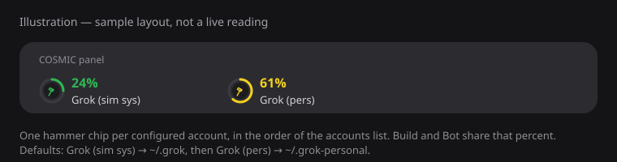
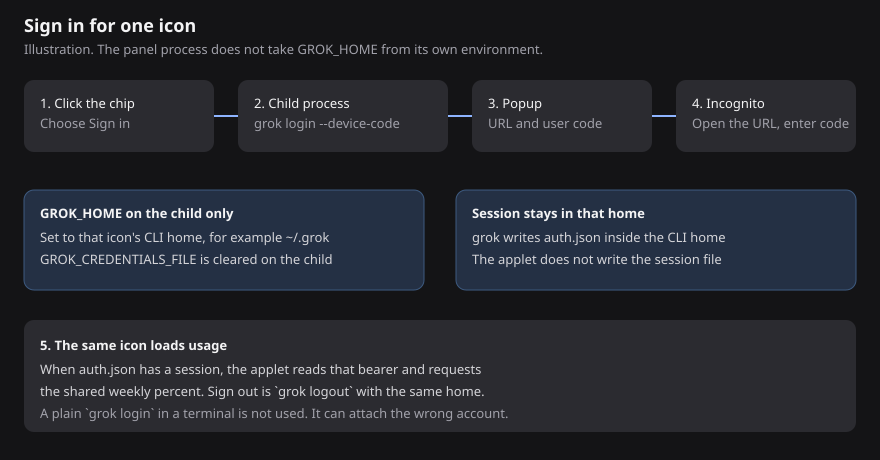
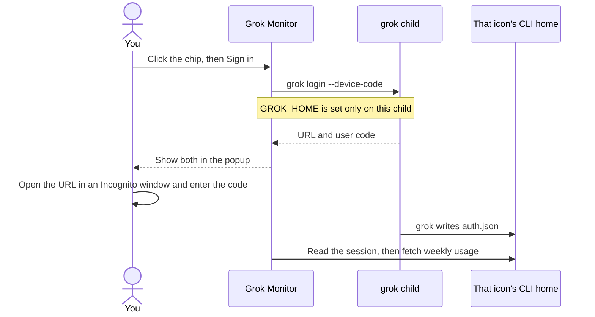
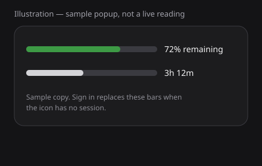
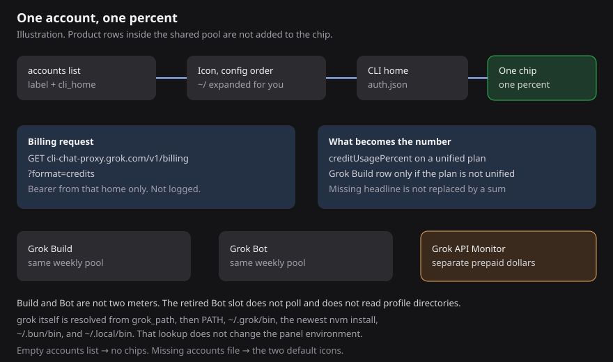
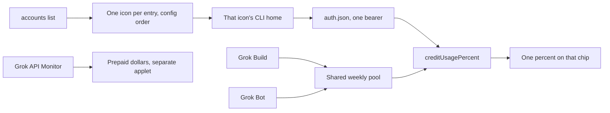

# Grok Monitor

A panel applet for the [COSMIC™](https://github.com/pop-os/cosmic-epoch) desktop
on Pop!_OS 24.04. It shows the shared weekly Grok usage pool **once per
configured account**. Grok Build and Grok Bot draw from that pool on current
xAI plans, so a second Bot meter would count the same usage again. The chip
uses the same billing endpoint as `/usage` in the Grok CLI
(`creditUsagePercent`).

A second applet, **Grok API Monitor**, shows remaining prepaid dollars for xAI
API tokens. It is not part of the weekly chips.

The default panel, when you have not written an accounts file, is two icons in
this order:

| Chip | CLI home |
|------|----------|
| **Grok (sim sys)** | `~/.grok` |
| **Grok (pers)** | `~/.grok-personal` |

The panel shows only the icons in your accounts list, in that order. It does
not scan CLI homes or Grok Bot profiles to invent extra icons.

**Grok Bot Monitor** is a retired panel slot. It does not poll usage and it
does not read Grok Bot profile directories. Remove it from the panel after
updating. The package does not edit the panel layout. That step is in COSMIC
Settings.

This is an unofficial community project. It is not affiliated with, endorsed
by, or supported by xAI or Cursor.



*Illustration. The percents in the picture are a sample layout, not a live reading.*

## Contents

- [Requirements](#requirements)
- [Install](#install)
- [Add it to the panel](#add-it-to-the-panel)
- [Configure accounts](#configure-accounts)
- [Every config key](#every-config-key)
- [Sign in and sign out](#sign-in-and-sign-out)
- [What the chip and popup show](#what-the-chip-and-popup-show)
- [How a reading is produced](#how-a-reading-is-produced)
- [Weekly pace](#weekly-pace)
- [Grok API Monitor](#grok-api-monitor)
- [Troubleshooting](#troubleshooting)
- [Uninstall](#uninstall)
- [Development](#development)
- [Privacy](#privacy)
- [License](#license)

## Requirements

To run a packaged build:

- The COSMIC™ desktop (Pop!_OS 24.04 or another COSMIC session)
- A [Grok CLI](https://grok.com) named `grok` for Grok Monitor
- A [Management API key](https://docs.x.ai/developers/management-api-guide) for
  Grok API Monitor only

To build from source:

- Rust 1.88 or newer (edition 2024), via [rustup](https://rustup.rs)
- `pkg-config`, a C toolchain, and the libxkbcommon, wayland, expat,
  fontconfig, and freetype development headers
- [`just`](https://github.com/casey/just) is optional. It wraps the Cargo and
  install commands below.

On Debian, Ubuntu, and Pop!_OS:

```sh
sudo apt install build-essential pkg-config libxkbcommon-dev \
  libwayland-dev libexpat1-dev libfontconfig-dev libfreetype6-dev
```

Fedora equivalents: `libxkbcommon-devel`, `wayland-devel`, `expat-devel`,
`fontconfig-devel`, `freetype-devel`.

## Install

Pick one of the three methods. All of them install the same binary. The
`.desktop` files register three applets: Grok Monitor, the retired Grok Bot
Monitor slot, and Grok API Monitor.

### Debian package

On Pop!_OS 24 or Ubuntu 24.04 amd64, download the `.deb` from
[GitHub Releases](https://github.com/simple-systems-se/grok-mon/releases):

```sh
sudo apt install ./cosmic-ext-applet-grok-monitor_*_amd64.deb
```

`apt install` of a newer `.deb` replaces the binary. It does not change which
applets are pinned to the panel.

### Binary tarball

Each release also has a stripped tarball,
`cosmic-ext-applet-grok-monitor-<version>-linux-amd64.tar.gz`, for a user
install without `apt`. It contains the binary, `LICENSE`, `README.md`, and
`res/`.

```sh
tar -xzf cosmic-ext-applet-grok-monitor-*-linux-amd64.tar.gz
cd cosmic-ext-applet-grok-monitor-*-linux-amd64
install -Dm0755 cosmic-ext-applet-grok-monitor ~/.local/bin/cosmic-ext-applet-grok-monitor
```

Then install the desktop files, icons, and metainfo from `res/` the same way
as the from-source steps below. Point `Exec=` at
`$HOME/.local/bin/cosmic-ext-applet-grok-monitor`.

### From source

```sh
git clone https://github.com/simple-systems-se/grok-mon.git
cd grok-mon
just install-user
```

`just install-user` builds the release binary and installs it for the user
running the command (`~/.local`). It does not change other users, and it does
not remove an applet that is already pinned.

Without `just`:

```sh
cargo build --release

install -Dm0755 target/release/cosmic-ext-applet-grok-monitor \
  ~/.local/bin/cosmic-ext-applet-grok-monitor

mkdir -p ~/.local/share/applications ~/.local/share/metainfo
sed "s|^Exec=.*|Exec=$HOME/.local/bin/cosmic-ext-applet-grok-monitor|" \
  res/io.github.simple-systems-se.grok-mon.desktop \
  > ~/.local/share/applications/io.github.simple-systems-se.grok-mon.desktop
sed "s|^Exec=.*|Exec=$HOME/.local/bin/cosmic-ext-applet-grok-monitor --product=bot|" \
  res/io.github.simple-systems-se.grok-mon-bot.desktop \
  > ~/.local/share/applications/io.github.simple-systems-se.grok-mon-bot.desktop
sed "s|^Exec=.*|Exec=$HOME/.local/bin/cosmic-ext-applet-grok-monitor --product=api|" \
  res/io.github.simple-systems-se.grok-mon-api.desktop \
  > ~/.local/share/applications/io.github.simple-systems-se.grok-mon-api.desktop

for id in io.github.simple-systems-se.grok-mon \
          io.github.simple-systems-se.grok-mon-bot \
          io.github.simple-systems-se.grok-mon-api
do
  install -Dm0644 "res/icons/hicolor/scalable/apps/${id}.svg" \
    "$HOME/.local/share/icons/hicolor/scalable/apps/${id}.svg"
  install -Dm0644 "res/icons/hicolor/scalable/apps/${id}.svg" \
    "$HOME/.local/share/icons/hicolor/scalable/apps/${id}-symbolic.svg"
  install -Dm0644 "res/${id}.metainfo.xml" \
    "$HOME/.local/share/metainfo/${id}.metainfo.xml"
done
```

## Add it to the panel

1. Open **COSMIC Settings → Desktop → Panel → Applets**.
2. Add **Grok Monitor**, and **Grok API Monitor** if you watch prepaid API
   credit.
3. Do not add **Grok Bot Monitor**. If it is already on the panel from an
   older install, remove it here. The package keeps that desktop file so the
   slot does not go blank; the slot only tells you to remove it.
4. If a newly installed applet does not appear, restart the panel:

```sh
pkill -x cosmic-panel
```

`-x` matches the process name `cosmic-panel` exactly. COSMIC starts the panel
again on its own.

## Configure accounts

Grok Monitor shows one chip per entry. It does not merge two entries that
share an email, and it does not add their percents together.

The list is the COSMIC config key `accounts`:

```
~/.config/cosmic/io.github.simple-systems-se.grok-mon/v1/accounts
```

The file is [RON](https://github.com/ron-rs/ron). Each entry has `label` and
`cli_home`. `cli_home` is that icon's Grok CLI home. The applet passes the
expanded path as `GROK_HOME` only to the `grok` process for that icon. A
leading `~/` is expanded for the current user. `~other/…` is rejected. Order
in the file is the panel order.

```ron
[
    (
        label: "Grok (sim sys)",
        cli_home: "~/.grok",
    ),
    (
        label: "Grok (pers)",
        cli_home: "~/.grok-personal",
    ),
]
```

| Accounts file | What the panel shows |
|---------------|----------------------|
| Key missing | **Grok (sim sys)** then **Grok (pers)** |
| `[]` | No icons |
| A list | Exactly those icons, in order |
| Present, but not valid RON | No icons, and a config error on the panel |

Editing `accounts` does not require the settings UI. The other keys below are
sibling files in the same `v1` directory.

Panel labels come from each entry's `label`. An empty label falls back to the
`cli_home` text you wrote. The popup **Settings** page edits the label of the
icon you opened.

## Every config key

COSMIC stores each key as its own RON file under:

```
~/.config/cosmic/io.github.simple-systems-se.grok-mon/v1/
```

Grok API Monitor uses the same key names under
`io.github.simple-systems-se.grok-mon-api`. The retired Bot id
`io.github.simple-systems-se.grok-mon-bot` is left on disk. It is not used to
choose Grok Monitor icons.

| Key | Default | Applies to | What it does |
|-----|---------|------------|--------------|
| `poll_secs` | `60` | Grok and API | How often to refresh. The settings buttons are 30s, 60s, and 5m (300). Values outside 15–600 seconds are clamped. |
| `show_sparkline` | `false` | Grok and API | Draw a small history beside the chip. |
| `show_percent` | `true` | Grok | Show the whole-number percent on the chip. `—`, `…`, and `?` still show when there is no reading. |
| `show_percent` | `true` | API | Show the dollar amount on the chip. The settings row calls this “Amount on panel”. |
| `show_remaining` | `false` | Grok | `false` shows percent used on the chip. `true` shows percent remaining on the chip. The ring fill follows this. Color always follows percent used. The popup usage bar always shows percent remaining. |
| `show_pace` | `true` | Grok | Still loaded and saved. The popup does not show a pace line. Settings keeps the switch. |
| `account_labels` | `{}` | API, and preserved on Grok | Map of chip id to label. Grok Monitor chip text comes from `accounts[].label`. The map is still loaded and written back with the rest of the config, so an existing file is kept. API Monitor uses the entry `"default"`. |
| `accounts` | the two icons above | Grok | Panel icons. See the table in [Configure accounts](#configure-accounts). |
| `grok_path` | `""` | Grok | Optional path to the `grok` binary. Empty means search. See below. |

`show_remaining` does nothing on the API chip. That chip is remaining dollars,
and its ring is full at $50 remaining.

Example `grok_path` file (`v1/grok_path`), a RON string:

```ron
"/home/you/.grok/bin/grok"
```

A leading `~/` is expanded. Symlinks are followed. The file must be a regular
executable. An empty string, a missing file, or a non-executable is skipped
and the search continues.

These older names are **not** read by 0.4.x. Leaving the files on disk is
harmless; COSMIC ignores keys this version does not list:

| Leftover file | What to do |
|---------------|------------|
| `cli_homes` | Not a 0.4 key. Put each home in `accounts`. |
| `warn_percent`, `critical_percent` | Not read. Color is a continuous scale, not two thresholds. |

## Sign in and sign out

Sign in from the icon whose CLI home should receive the session. The popup
shows the URL and the user code. It does not open the system browser.





1. Click the chip and choose **Sign in**.
2. The applet runs `grok login --device-code` (`--device-code` is the alias of
   `--device-auth`). It does not run a plain `grok login` or
   `grok login --oauth`, because those open the system browser.
3. `GROK_HOME` on that child is the expanded CLI home for the icon.
   `GROK_CREDENTIALS_FILE` is removed from the child so another home cannot
   redirect the session. The panel process keeps its own environment.
4. Copy the URL or the code from the popup if you want. Open the URL in an
   **Incognito** window and enter the code. A normal window can attach whichever
   account is already signed in there.
5. The popup waits until that home has a session, you press **Cancel**, or the
   login fails. The URL and the code are not written to the log.
6. **Sign out** runs `grok logout` with `GROK_HOME` set to that same home.

Do not run `grok login` or `grok logout` in a terminal for these icons. The
shell's `GROK_HOME` may be a different account.

### Session refresh

`auth.json` is a map of scope to credential. For the one session a chip uses,
the applet reads `key`, `expires_at`, `email`, and `principal_type`. It does
not read or write `refresh_token`. The CLI keeps that refresh token and, when
the CLI runs, replaces the access token and writes a new `expires_at`.

The access token's `expires_at` is often well under a day. Grok Monitor used
to read that timestamp and show **session expired** as soon as it passed,
including for an account that was still signed in. The CLI would have renewed
the token the next time it ran. An icon that is not used in a terminal never
got that run.

When the session this chip would use is within 5 minutes of `expires_at`, or
already past it, the applet runs `grok models` once for that icon's CLI home,
then reads `auth.json` again and fetches usage. Five minutes is the CLI's
default early-refresh window. `grok models` is an unattended command: it
lists models and boots the CLI's own locked refresh. The applet does not
attach a terminal, so this run cannot prompt. `grok usage` is not used. That
command prints saved per-session cost and does not refresh the login.

The child is not a TTY. Its standard input, output, and error are discarded.
`GROK_HOME` on that child is this icon's home, and `GROK_CREDENTIALS_FILE` is
removed from the child. The panel process environment is not changed. The
arguments are `models` only: not `login`, not `logout`, and not
`--device-code`. The same `grok` binary search as sign-in is used. The child
is stopped if it is still running after 60 seconds.

A failure waits before the next try for that CLI home: 5 minutes, then 10,
20, 40, and so on, up to 6 hours. The wait is kept in memory and clears after
a refresh that leaves a session outside the 5-minute window. Two icons that
share a home share one try. A sign-in or sign-out that is already running for
that home is left alone. There is no settings key for this. It is always on.

The log line names the chip index and the CLI home path, and says that a
renewal was attempted, succeeded, or failed, with the exit code or timeout.
It does not include a token or an email address.

If the command does not leave a usable session, the chip stays on `—` and the
popup keeps **Sign in**.

The `grok` binary is resolved once per launch, in this order. The search does
not change the panel's `PATH` or `HOME`:

1. `grok_path`, when it is a non-empty path to a regular executable.
2. The first regular executable named `grok` on `PATH`.
3. `~/.grok/bin/grok`
4. The newest `~/.nvm/versions/node/*/bin/grok`, by Node's semantic version,
   not by file modification time. A stable release sorts above a prerelease
   with the same numbers.
5. `~/.bun/bin/grok`
6. `~/.local/bin/grok`

Directories, broken symlinks, and files without an execute bit are skipped.
If nothing usable is found, the popup says the grok CLI was not found and
lists the places it checked. It does not show a raw operating-system error
number.

## What the chip and popup show



*Illustration. The percent and the duration in the picture are sample copy, not a live reading. A signed-in popup with a reading is these two bars.*

The chip is a circular usage ring (the same shape Minimon uses for memory)
with a hammer (Grok) or a key (API) in the center. The ring, the track, and
the popup body use opaque theme colors. By default a Grok chip shows the
shared pool as a whole percent used. Settings can hide the number or switch
the number and the ring fill to percent remaining. The chip text does not
include a reset countdown.

Color follows percent **used**, with a distinct shade at each whole percent:
green through 50%, yellow through 80%, orange through 90%, red above that.
For API, percent used is remaining prepaid mapped against a $50 full wallet
(green above $25, yellow through $10, orange through $5, red under $5).

Click a Grok chip that has a reading and does not need an action. The popup
shows two bars and nothing else:

- **Usage bar.** The fill is percent remaining (`100 − used`, clamped to
  0–100). The label is that percent, rounded, as `72% remaining`. Color still
  follows percent used, so a short remaining bar is red.
- **Time bar,** directly under it. The fill is the fraction of the current
  window still left: `(reset − now) / (reset − start)`, clamped to 0–100.
  The label is only the compact time until reset, such as `3h 12m` or
  `2d 4h`. It does not say “resets in” or “resets at”.

There is no plan name, email, CLI home, pace sentence, “updated … ago” line,
or live-session line in that state. **Sign out**, **Open usage**, **Copy**,
and **Settings** are not on that popup either. Edit the COSMIC config files
for those keys, or use **Settings** from a popup that has no reading.

The window length comes from the billing period start and end. If the payload
has a reset time but no positive start→end window, the duration label is
still shown and the time bar is empty. The applet does not assume a 7-day
week. If the reset time itself is missing, the label is `—` and the bar is
empty. A reset that is already past shows `0m` and an empty time bar.

When the icon has no reading, the popup keeps the controls that need you:

- **Sign in**, or the device-code URL, user code, **Copy URL**, **Copy code**,
  and **Cancel** while sign-in is in progress
- The error text, when the last request failed or the CLI home is unusable
- **Sign out** when a reading is on screen and a sign-out or a failed poll
  still needs the button
- **Open usage**, **Copy**, and **Settings** only when there is no reading

| Chip | Meaning |
|------|---------|
| `…` | Fetching, or a sign-in is in progress |
| `—` | Not signed in, or the session has expired |
| `?` | Request failed, the accounts file could not be read, or there is no previous reading |
| dimmed percent | Last good reading is still shown; the latest poll failed |

On Grok API Monitor, `—` means the Management API key is missing or rejected.

## How a reading is produced





The percent is `creditUsagePercent` from
`GET https://cli-chat-proxy.grok.com/v1/billing?format=credits`. On a unified
plan that number is the shared weekly pool (Build, Bot, Chat, and the other
Grok products). `productUsage` rows are a breakdown of the same pool. They are
not added to the headline, and the old Grok Bot ledger is not added either.

One home with several session entries still produces one chip. The applet
prefers one unexpired `https://auth.x.ai::` entry. The chip count comes from
config.

If the headline percent is missing on a unified plan, the chip does not invent
a total by summing product rows. A legacy plan that is not unified still uses
the Grok Build row only, when that is all the payload has.

Before that fetch, a session that is within 5 minutes of `expires_at` or
already past it is handed to `grok models` for that home, as described in
[Session refresh](#session-refresh). The applet then reads `auth.json` again.

The bearer is sent only to `https://cli-chat-proxy.grok.com` (`/v1/billing`
and `/v1/settings`). Tokens, device codes, and account ids are not written to
the log. The panel label is not written to the log either. A renewal log
names the chip index and the CLI home only.

## Weekly pace

`show_pace` is still loaded and saved, and Settings still has the switch.
Version 0.4.4 does not draw a pace line. The popup's second bar is the time
left in the current window (`reset − now`, over `reset − start`). It is not
a burn-rate forecast, and it does not assume a 7-day week when the payload
has no period start.

Grok API Monitor has no usage-window start or end, so its popup is unchanged:
remaining prepaid dollars, optional spend, key names, and **Open console**.

## Grok API Monitor

Launch it as `cosmic-ext-applet-grok-monitor --product=api`, or add **Grok API
Monitor** to the panel. It has its own chip, settings, and credentials.

The chip shows remaining **prepaid API dollars** (the same remaining-credit
figure as [console.x.ai](https://console.x.ai) billing). Click for optional
spend this billing period, up to three API key names on the team, and
**Open console**.

Auth is a **Management API key**, not an inference API token. Create one in
the xAI Console under **Settings → Management Keys** with billing read access,
then write it to `~/.config/grok-mon-api/credentials.json` (`chmod 600`
recommended):

```json
{
  "management_key": "xai-...",
  "team_id": "optional-uuid"
}
```

`team_id` is optional for a team-scoped key (the applet reads it from key
validation). Organization-scoped keys need `team_id` or `XAI_TEAM_ID`.
Environment variables `XAI_MANAGEMENT_API_KEY` (or `XAI_MANAGEMENT_KEY`) and
`XAI_TEAM_ID` override the file when the panel process has them. The applet
does not write that file. Inference keys (`XAI_API_KEY`) are rejected.

Live remaining is the lower of two figures when both exist: the posted prepaid
ledger (`/v1/billing/teams/{team}/prepaid/balance`) minus current-period spend,
and the invoice preview's `prepaidCredits`
(`/v1/billing/teams/{team}/postpaid/invoice/preview`). Spend is the largest of
`prepaidCreditsUsed`, `totalWithCorr`, and invoice line amounts. Mid-cycle,
preview `prepaidCredits` can lag live spend, so posted minus spend is lower.
At a billing-cycle change the previous invoice may not be posted to the ledger
yet, while preview `prepaidCredits` already includes that spend and
`prepaidCreditsUsed` is still zero, so the preview figure is lower. When the
ledger is missing, preview remaining is the fallback. Ledger amounts are
inverted USD cents (`"-1000"` is $10 remaining). A missing total is never
treated as $0.00.

The Management API key is sent only to `https://management-api.x.ai`.

## Troubleshooting

### The popup says the grok CLI was not found

The panel's `PATH` often does not include `~/.grok/bin` or nvm. Read the list
of places in the popup. Either install `grok` in one of those places, or set
`grok_path` to the executable. The next **Sign in**, and the quiet `grok models` refresh, use the new path.
You do not need to restart the panel for that.

A file that exists but is not executable is skipped. `chmod +x` the binary, or
point `grok_path` at the real file rather than a directory.

### The chip shows `—` (session expired or signed out)

The applet first tries `grok models` for that icon's home when the access
token is within 5 minutes of expiry or already expired. If that refresh
works, the next reading replaces `—`. A normal access-token expiry does not
need another sign-in.

**Sign in** remains when that home has no session, the CLI rejects the refresh
token, `grok` cannot be started, or the quiet attempt timed out and the next
try is still waiting. Open that icon and choose **Sign in**. Finish the code
in an Incognito window. **Sign out** on the other icon first if you attached
the wrong account.

A `—` that returns within a few minutes of a failed refresh is the backoff,
not a new sign-out. The log line `session renewal failed` includes the chip
index, the CLI home, and the exit code or timeout. It does not include the
token or the email.

On Grok API Monitor, `—` means the Management API key is missing or rejected.
An inference key will not work. Check
`~/.config/grok-mon-api/credentials.json` and `XAI_MANAGEMENT_API_KEY`.

### The chip shows `?`

The last request failed, or the accounts file is not valid RON. Open the chip.
The popup includes the error, or it names the accounts file when that file
could not be parsed. A dimmed percent means an older reading is still on the
chip and only the latest poll failed.

### There are no chips

An accounts file of `[]` shows nothing. That is intentional. Delete the file
to restore the two defaults, or add entries. A file that is not valid RON also
shows no account chips; it shows one `?` chip whose popup is the config error.

A missing accounts file is not the empty state. Missing means the two default
icons.

### Sign-in attached the account that was already in the browser

That happens when the device-code page is opened in a normal window. Sign out
from the affected icon, then sign in again and open the URL in Incognito.

### The applet does not appear after install

Restart the panel, then add it in Settings:

```sh
pkill -x cosmic-panel
```

Log out and back in if the desktop files were installed while COSMIC was not
looking at `~/.local/share/applications`.

### Grok Bot Monitor is still on the panel

Remove it in **COSMIC Settings → Desktop → Panel → Applets**. Clicking it
shows a removal note. It does not fetch usage and it does not open Grok Bot
profile directories.

## Uninstall

Debian package:

```sh
sudo apt remove cosmic-ext-applet-grok-monitor
```

User install:

```sh
just uninstall-user
```

Without `just`:

```sh
rm -f ~/.local/bin/cosmic-ext-applet-grok-monitor \
  ~/.local/share/applications/io.github.simple-systems-se.grok-mon.desktop \
  ~/.local/share/applications/io.github.simple-systems-se.grok-mon-bot.desktop \
  ~/.local/share/applications/io.github.simple-systems-se.grok-mon-api.desktop \
  ~/.local/share/icons/hicolor/scalable/apps/io.github.simple-systems-se.grok-mon.svg \
  ~/.local/share/icons/hicolor/scalable/apps/io.github.simple-systems-se.grok-mon-symbolic.svg \
  ~/.local/share/icons/hicolor/scalable/apps/io.github.simple-systems-se.grok-mon-bot.svg \
  ~/.local/share/icons/hicolor/scalable/apps/io.github.simple-systems-se.grok-mon-bot-symbolic.svg \
  ~/.local/share/icons/hicolor/scalable/apps/io.github.simple-systems-se.grok-mon-api.svg \
  ~/.local/share/icons/hicolor/scalable/apps/io.github.simple-systems-se.grok-mon-api-symbolic.svg \
  ~/.local/share/metainfo/io.github.simple-systems-se.grok-mon.metainfo.xml \
  ~/.local/share/metainfo/io.github.simple-systems-se.grok-mon-bot.metainfo.xml \
  ~/.local/share/metainfo/io.github.simple-systems-se.grok-mon-api.metainfo.xml
```

Then remove **Grok Monitor**, **Grok Bot Monitor**, and **Grok API Monitor**
from the panel if they are still listed.

Settings stay in COSMIC config until you purge them:

```sh
just purge-user
```

That also removes:

```
~/.config/cosmic/io.github.simple-systems-se.grok-mon/
~/.config/cosmic/io.github.simple-systems-se.grok-mon-bot/
~/.config/cosmic/io.github.simple-systems-se.grok-mon-api/
```

It does not delete `~/.config/grok-mon-api/credentials.json`, `~/.grok`, or
`~/.grok-personal`.

## Development

From a git checkout, with the system packages in
[Requirements](#requirements):

```sh
cargo fmt --check
cargo clippy --all-targets -- -D warnings
cargo test
cargo build --release --locked
bash scripts/package-linux.sh
```

`scripts/package-linux.sh` does not compile. It packs `target/release` into
`dist/*.deb` and `dist/*.tar.gz`, then writes `dist/SHA256SUMS`. `just package-linux`
builds with `--locked` and then runs that script. `VERSION=1.2.3 just package-linux`
overrides the package version (a leading `v` is stripped). The default version
is `version` in `Cargo.toml`.

`just` equivalents:

```sh
just test
just check
just fmt
just build-release
just package-linux
just run
just run -- --product=api
```

`just check` is clippy with `-D warnings`. `just fmt` rewrites sources.
`just run` sets `RUST_LOG=cosmic_ext_applet_grok_monitor=info`.

Tagged `v*` pushes run `.github/workflows/release.yml` on `ubuntu-24.04` and
attach a `.deb` plus binary tarball to a GitHub Release. **Actions → Release →
Run workflow** builds those artifacts without publishing. This tree does not
tag or publish on its own.

Run the API applet from Cargo:

```sh
RUST_LOG=cosmic_ext_applet_grok_monitor=info cargo run --release -- --product=api
```

The retired slot is `--product=bot`.

## Privacy

Grok Monitor reads `auth.json` and `active_sessions.json` in each configured
CLI home. It sends that home's bearer only to
`https://cli-chat-proxy.grok.com`. It starts `grok login --device-code`,
`grok logout`, or, when that home's access token is near expiry, `grok models`.
`GROK_HOME` is set on that child only. The device-code URL and user code are
shown in the popup and are not written to the log. Renewal output is
discarded. Tokens and email addresses are not written to the log.

Grok Monitor does not read Grok Bot profile files to build the icon list. The
retired slot does not poll and does not open those directories.

Grok API Monitor reads `~/.config/grok-mon-api/credentials.json` and the
`XAI_MANAGEMENT_API_KEY` / `XAI_MANAGEMENT_KEY` / `XAI_TEAM_ID` environment
variables when present. It sends the Management API key only to
`https://management-api.x.ai`.

None of the applets write session files or API keys themselves. The
Authorization header is marked sensitive so HTTP debug traces redact it.
In-memory secrets are zeroized when dropped. See [SECURITY.md](SECURITY.md)
for how to report a vulnerability. Do not attach `auth.json`, credentials, or
tokens.

## License

This is free and unencumbered software released into the public domain.
See [LICENSE](LICENSE) (Unlicense).

[libcosmic](https://github.com/pop-os/libcosmic) is MPL-2.0. Other crates keep
their own licenses; see `Cargo.lock`.

Grok is a trademark of xAI. Cursor is a trademark of Anysphere. COSMIC is a
trademark of System76. The names are used here only to identify the Grok
products, the COSMIC™ desktop, and the usage endpoint the Grok CLI already
calls. This is an unofficial community project.
